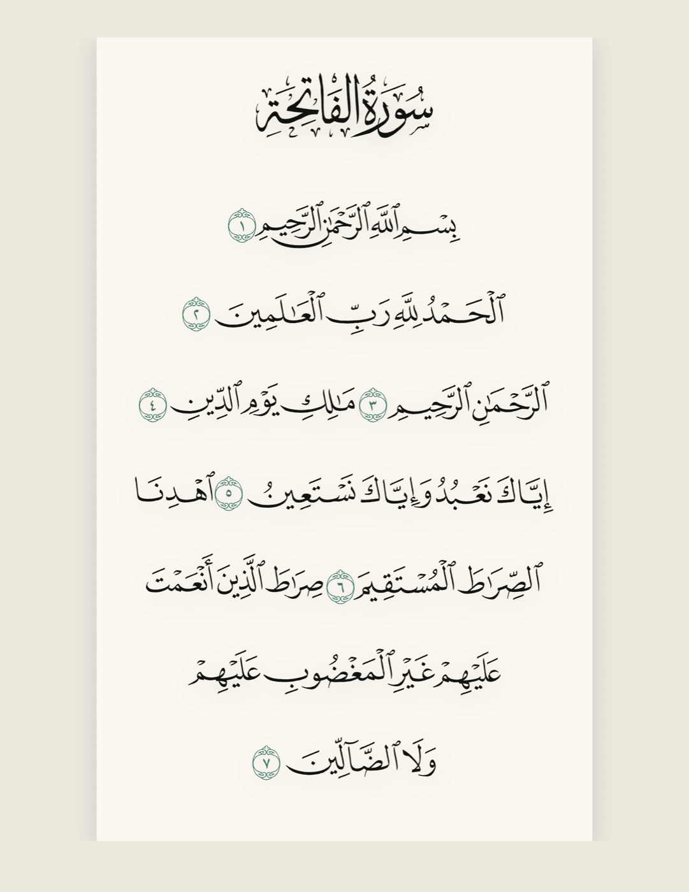
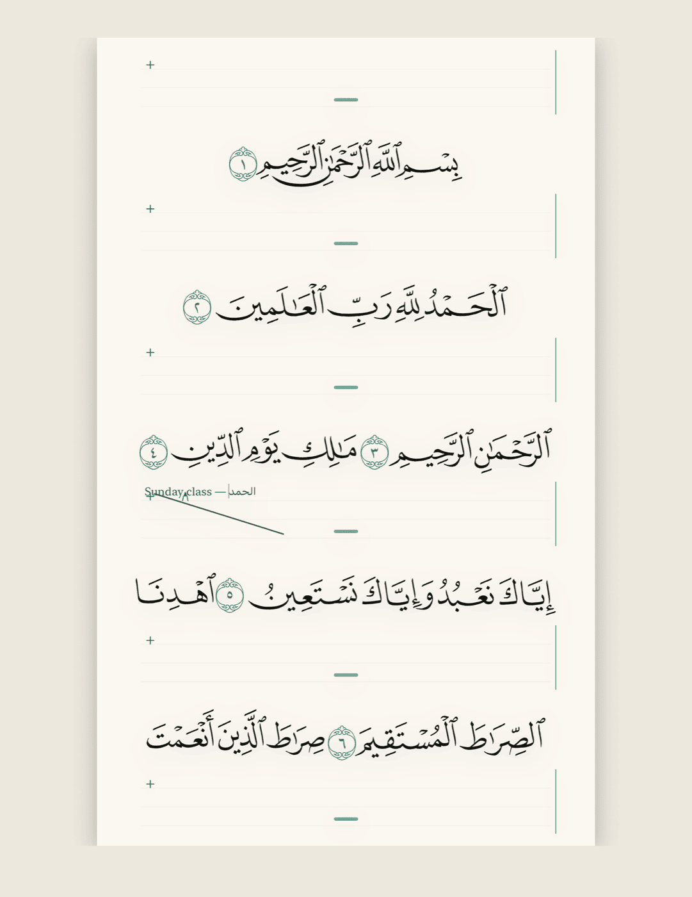
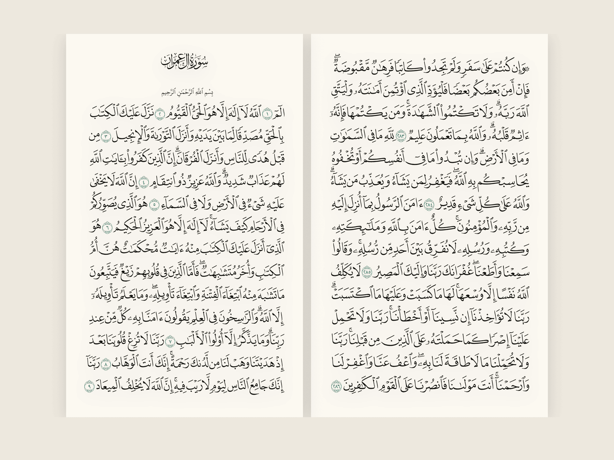
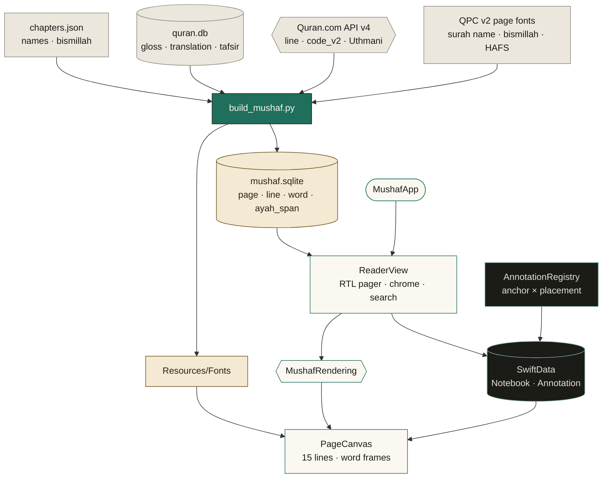
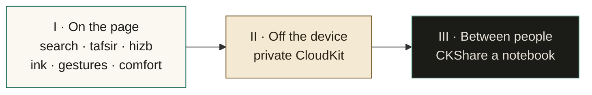

<!-- HERO SECTION -->
<p align="center">
  
  <br>
  <strong>A printed Madani mushaf that opens between the lines for your notes, then closes back to a quiet page.</strong>
</p>

<p align="center">
  
  
  
  
</p>

---

<p align="center">
  <em>The page is the subject. The app is the margin.</em>
</p>

Mushaf is an iPad reader for the 15-line Madani mushaf: 604 pages, right-to-left, one sheet on a desk. Chrome stays hidden until a finger asks for it. Notes live in notebooks — handwritten, typed, or both — and sit beside or between the lines, never on the Arabic.

---

### 🎨 Visual Preview & Presentation

> Drop screenshots into `docs/preview/`. The page should read as paper on a slightly darker desk: portrait is one sheet, landscape is a facing spread with the odd page on the right. Crop to the page, not the simulator chrome.

<table>
  <tr>
    <td width="50%" align="center" valign="top">
      
      <br>
      <sub><b>Plain page</b> · Paper theme, portrait. Surah header, bismillah, ayah text. Nothing else.</sub>
    </td>
    <td width="50%" align="center" valign="top">
      
      <br>
      <sub><b>Open page</b> · Interlinear bands, active notebook tint on the leading edge, highlights behind the words.</sub>
    </td>
  </tr>
</table>

<p align="center">
  
  <br>
  <sub>Landscape spread · odd page on the right. Sidebar cards align to their line; stickies sit on the desk, or collapse to a dot.</sub>
</p>

---

### ✨ Key Capabilities

- **📖 The page, first.** Open the app and you are on the last page you read. A finger tap reveals the surah, juz, and a scrubber with juz ticks. A swipe turns the page. The Pencil never pages.
- **✒️ Notes that make room.** Interlinear bands open under the fifteen lines and grow with the ink. A grabber lengthens a band before you write; a double-tap fits it back to the content.
- **🗂️ Notebooks as layers.** One notebook is writable. Up to three can show at once. The others render dimmed, in their own hue, and a tap offers to switch — it never edits.
- **🖍️ Five kinds of mark.** Interlinear, sidebar, sticky, highlight, and a dictionary card (gloss, root, lemma, plus your own definition). An unknown kind stays on the page as a small chip.
- **🌙 Paper, Sepia, Night.** Three palettes, plus Auto. Quran ink stays neutral. Colour belongs to notebooks and highlights. The Arabic size follows the page, not Dynamic Type.
- **🔎 Find, then return.** Jump by surah, page, or ayah, and search the notes on screen, including recognized interlinear ink. Export a notebook as PDF or a JSON backup.

---

### 📐 Architecture & System Flow

The mushaf is read-only and bundled. Notes are SwiftData on the device. A note is anchored to a page, line, ayah, or word; interlinear, sidebar, and sticky are ways of showing that anchor.



| Folder | What it holds |
| --- | --- |
| `App/` | SwiftUI entry. SwiftData container for notebooks and annotations. |
| `Design/` | Paper, Sepia, Night, eight notebook hues, type roles. |
| `Mushaf/` | Store, page canvas, glyph renderer, finger pager. |
| `Annotations/` | Registry, bands, sidebar, stickies, dictionary, export. |
| `scripts/` | Build the sqlite, fetch fonts, check the 604 pages. |
| `Resources/` | `mushaf.sqlite` and fonts. Both are generated, and gitignored. |

---

### 🚀 Getting Started & Setup

iPadOS 26 or later. Xcode with the iOS 26 SDK. Python 3. The build reads a local corpus at `~/dev/arabic-proj/data` and downloads the page layout and fonts on first run.

```bash
# chapters.json and quran.db must already live here
ls ~/dev/arabic-proj/data/raw/qurancom/chapters.json ~/dev/arabic-proj/data/quran.db

# 604 API pages, QPC fonts, then Resources/mushaf.sqlite
# caches land in scripts/cache (gitignored)
python3 scripts/build_mushaf.py

# 15 lines on every page except 1–2; every ayah once, in order
python3 -m unittest scripts/test_mushaf.py

# scheme: Mushaf · destination: an iPad
open Mushaf.xcodeproj
```

> The first build talks to Quran.com and the font CDN. Later runs reuse `scripts/cache` and skip files that are already on disk.

---

### 🛠️ Configuration

There is no `.env`. Reading state lives in `UserDefaults`. The build script uses fixed paths.

| Key | Default | What it does |
| --- | --- | --- |
| `mushaf.theme` | `auto` | `auto`, `paper`, `sepia`, or `night`. Auto follows the system: Night in dark, Paper in light. |
| `mushaf.lastPage` | `1` | Page restored on the next launch. `1`…`604`. |
| `mushaf.activeNotebook` | — | UUID of the one notebook that accepts new ink. |
| `mushaf.visibleNotebooks` | — | Comma-separated UUIDs shown with the active notebook. |
| `mushaf.archivedNotebooks` | — | Comma-separated UUIDs kept out of the switcher. |
| `~/dev/arabic-proj/data` | — | `raw/qurancom/chapters.json` and `quran.db`. Read only. |

| Theme | Desk | Paper | Quran ink | Ayah marker |
| --- | --- | --- | --- | --- |
| Paper | `#ECE7DD` | `#FBF8F1` | `#1B1B18` | `#1F6F5C` |
| Sepia | `#E3D6BC` | `#F4E9D2` | `#2A2116` | `#6B4E1E` |
| Night | `#0F1110` | `#1A1C1B` | `#E6E1D6` | `#7FBFA8` |

Notebook hues: Teal, Indigo, Saffron, Rose, Olive, Slate, Plum, Clay. Each has a tint for the band edge, a wash behind highlights, and an ink for the pen.

Launch arguments, for screenshots and design checks:

```text
-theme paper|sepia|night|auto
-page 50
-notes          # open interlinear
-type           # open interlinear on the keyboard
-sidebar -sticky -highlight -layers
-notebooks -dictionary -find <query>
-preset -ocr -pdf -tokens -unknown
```

---

### 🗺️ Roadmap

The page, the notebooks, and the five note kinds are on the desk. What follows is the work still ahead of them: three horizons, in the order a reader would feel them.



#### I · On the page

The bundle already holds more than the screen shows. These are readings and gestures the design named, still waiting for a hand.

| | Piece | Still to build |
| --- | --- | --- |
| 01 | **Corpus search** | Arabic text, the Clear Quran translation, gloss, and root. Filters for notebook, surah, and juz. Find today reaches a surah, a page, an ayah reference, and visible notes. |
| 02 | **Reference layers** | Tafsir and ruku titles sit in `src_tafsir` and `src_section` and never open. Decide whether they are a read-only layer or stay inside a card, then build that. |
| 03 | **Hizb** | Every page stores its hizb. The sheet and the scrubber speak only in juz. |
| 04 | **Ink you can find** | Vision reads interlinear drawings. Sidebar cards and stickies never schedule recognition, so that handwriting stays invisible to search. |
| 05 | **Gestures from the design** | Two-finger undo across the last 50 note edits. Pinch to zoom the page with its notes. A long-press on a band: keyboard, retarget the anchor to the ayah, move it to the sidebar, delete. |
| 06 | **Reading comfort** | A pinned Quran zoom, 1.25×–2×, with horizontal pan along the line. Increase Contrast and Reduce Transparency on rules and read-only layers. A numeral setting: Arabic-Indic on the page, Western in the chrome. VoiceOver names the surah, then the note after its line. |

#### II · Off the device

SwiftData is local. The model was already shaped for sync: optional fields, no unique constraints, annotations that never point outside their notebook.

| | Piece | Still to build |
| --- | --- | --- |
| 07 | **Private CloudKit** | The private database. The mushaf sqlite stays on the device and never syncs. Last writer wins, by `updatedAt`. |

#### III · Between people

| | Piece | Still to build |
| --- | --- | --- |
| 08 | **A shared notebook** | `CKShare`, one share per notebook. Classmates were always the unit. The share itself is the piece that does not exist yet. |

> **Two decisions before any of this grows.** Interlinear bands: under every line, or only under lines that already hold ink, with a tap to open the rest. Morphology: the corpus `segment` table was left out of the bundle; bring it in only if the dictionary should show parts of speech. Other mushaf layouts stay outside this book. Madani is the page.

---

<p align="center">
  <sub>Sources and licenses are listed in <a href="scripts/SOURCES.md">scripts/SOURCES.md</a>. Layout from Quran.com. Fonts are bundled unmodified. The Arabic is never stretched, recoloured, or used as texture.</sub>
</p>
